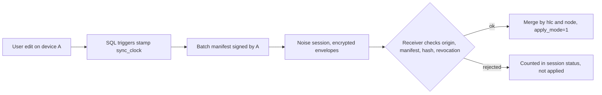

# WHPH Sync

WHPH syncs data between your own devices over the local network (LAN). No cloud
and no account are used. Every change is encrypted and signed by the device that
made it, and a device only talks to devices you paired.

This document is for users who run sync and for developers who change it. It
describes the engine that replaces the legacy paginated sync (protocol 1).
Planning and decision identifiers (D1, U10, FR-024 ...) come from the change
`0001-reliable-secure-lan-sync` and are quoted so you can trace them.

## Contents

- [Model](#model)
- [Protocol and versioning](#protocol-and-versioning)
- [Threat model](#threat-model)
- [Pairing](#pairing)
- [Key storage and backup exclusions](#key-storage-and-backup-exclusions)
- [Deletion records and privacy](#deletion-records-and-privacy)
- [Identity rules](#identity-rules)
- [Time records and set-total semantics](#time-records-and-set-total-semantics)
- [Upgrade from the legacy sync](#upgrade-from-the-legacy-sync)
- [Rolling back the upgrade](#rolling-back-the-upgrade)
- [Groups, restore, import and reset](#groups-restore-import-and-reset)
- [How to add a synced table](#how-to-add-a-synced-table)
- [Performance-test procedure](#performance-test-procedure)
- [Troubleshooting](#troubleshooting)
- [Real-surface QA](#real-surface-qa)

## Model

Sync is a per-cell replicated database in the style of cr-sqlite, implemented in
Dart and SQL (D1). There is no operation log.

- A **cell** is one column of one row. Row-level tables (time records, join
  tables, rules) use a single cell `*`. Every row also has an **existence cell**
  `~` whose value is the row's `deleted_date` (`NULL` means alive).
- Each cell carries a clock row in `sync_clock`: `(hlc, node, origin,
  origin_seq)`. The newest `(hlc, node)` wins; ties break by the lexicographic
  order of the member id (FR-004). Merging is commutative and idempotent, so
  devices converge in any order.
- **Change capture** (D3) uses SQLite triggers generated from the table policy,
  in pure SQL, so they work on every connection and isolate. Remote changes are
  applied with `sync_state.apply_mode != 0`, which stops the triggers from
  re-stamping them (D4). `modified_date` is a local revision and is never synced.
- **Two clocks** (D2): a hybrid logical clock (HLC, `wall_ms << 16 | counter`)
  decides conflicts; a per-device `origin_seq` drives sync cursors.
- **Cascaded deletes** (D5b): a child tombstone records its cause (the deleted
  parent). It is effective only while the parent is effectively deleted, so a
  revived parent revives the children deleted by the cascade. Children deleted
  on their own stay deleted.
- **Clock bootstrap** (D6): existing rows get a clock derived from their dates
  when the engine is first enabled. The first exchange with each peer is a
  full-state merge.



The pure-Dart core (HLC, version vectors, merge, canonical encoding, manifests,
Noise, envelopes, epochs, revocation, session state machine) lives in
`packages/whph_sync_core/` and has no Flutter dependency. The app wires it in
`src/lib/core/application/features/sync/` and the Drift persistence layer.

## Protocol and versioning

- `SYNC_PROTOCOL_VERSION = 2` (the legacy protocol is implicitly 1) and
  `MIN_COMPATIBLE_PROTOCOL_VERSION = 2` (D8).
- The handshake exchanges `{protocol_version, min_compatible, app_version,
  member_id, device_name, wall_ms}` before any user data. An incompatible peer
  produces `update_required` on both sides, naming the older device.
- A compatible newer peer may send fields or tables this version does not know.
  They are stored in `sync_held_cell` (kind `unknown`) with their clock and
  relayed unchanged (FR-042).
- Limits: frame ≤ 8 MiB, change value ≤ 2 MiB, batch ≤ 1,000 changes. Larger or
  malformed items are rejected and counted in the session status (FR-015).
- Transport is Noise `XX` (`Noise_XX_25519_ChaChaPoly_BLAKE2b`) over the
  existing WebSocket. Each side continues only if the peer's static key belongs
  to a non-revoked member; otherwise it closes before any user data.
- A minimal legacy responder (D10) answers v0.24.x devices so the older device
  gets a clear "update required" outcome instead of a silent failure. It does
  not sync data.

## Threat model

Goal: only paired devices read or change your data, on a network you do not
trust (café Wi-Fi, shared LAN).

| Threat | Mitigation |
| --- | --- |
| Eavesdropper on the LAN | Noise session plus per-change XChaCha20-Poly1305 envelopes under the group epoch key. |
| Unpaired device connects | Handshake closes before user data unless the static key belongs to a non-revoked member. |
| Replay or tampered change | Each change is hashed into a batch manifest signed by its author (Ed25519). Receivers check the origin registration, manifest signature and hash. Associated data binds group, epoch, table, pk, column, HLC, origin and sequence. |
| Stolen QR code | One-time 128-bit token, 5-minute expiry, consumed only after a passing `XXpsk3` handshake. Pairing handshakes are rate-limited per source address. |
| Man-in-the-middle during LAN-scan or manual pairing | Commit-reveal 6-digit code (SAS) that both screens must confirm. |
| Removed or lost device | Revocation records with per-origin cutoffs, then a new epoch key; the removed device cannot read later changes (FR-026). |
| Secrets leaking through export or logs | Key file and sync ledger are never in exports or logs; tests scan the DB, logs and export for key bytes (FR-027). |

The server also refuses connections whose source address is not a private LAN
address (HTTP 403). This is a coarse heuristic that trims noise from the public
internet; it is not a security boundary. A spoofed or same-LAN source passes it,
so the boundary is the Noise handshake and the member check described above.

### Accepted residual risks

- **HLC forward skew.** There is no forward clamp on remote HLCs. A member whose
  clock is far ahead can push the group's HLCs forward; this is accepted because
  it can only win genuinely concurrent conflicts (FR-003, FR-004) and never
  rewrites history. Only a malformed HLC (wall part ≥ 2^46 ms, or negative) is
  rejected.
- **Copied data directory.** Copying the whole app data directory to another
  machine copies the device identity. Two machines with one identity are not
  detected; keep the directory private. A restore of the same directory on the
  same device is detected (see [Groups, restore, import and reset](#groups-restore-import-and-reset)).
- **Windows ACL reliance.** On Windows the key file relies on the user-profile
  folder permissions, not a mode bit. Other accounts with access to your profile
  can read it.
- A device that holds a valid key and is not yet revoked can read everything
  until the revocation reaches it; revoke a lost device from another device as
  soon as you can.

## Pairing

1. **QR code (recommended).** The code holds the address list, port, member id,
   key fingerprint, a 128-bit one-time token and a 5-minute expiry. The scanner
   runs `Noise_XXpsk3` with the token and checks the fingerprint. Scanning the
   same code twice, or after 5 minutes, fails with "show a new code".
2. **LAN scan or manual address.** Noise `XX`, then a 6-digit code on both
   screens. Confirm only if they match. A mismatch, or cancel on either side,
   aborts both.

Pairing gives the joiner the current epoch key(s), its member entry and its
origin registration. Other members learn about the joiner transitively on their
next sync, so you pair a new device with one existing device only.

If you pair two devices that already belong to different groups, the joiner is
asked to confirm a **group switch**: its data merges into the other group and
its former partner can no longer sync with the new group.

## Key storage and backup exclusions

Two local files, written by one owner-only atomic writer (temp file with mode
`0600` before any byte is written, flush, rename, symlinks rejected):

- `sync_keys.json` (secret): identity private keys, member id, `group_id`, epoch
  keys, and a grow-only list of trusted member public keys (each with a sticky
  `revoked` flag).
- `sync_ledger.json` (not secret): the origin history and the highest sequence
  ever sent. Used at startup to detect that the database went backwards.

Both are excluded from export and from Android Auto Backup. On Android a
restore onto a new device therefore has no key file and the device must be paired
again (never reusing an origin). Never copy these files between devices.

## Deletion records and privacy

Deletion records are kept **indefinitely** (D9, U10). There is no tombstone
garbage collection, full resync or prune. This keeps restore and long-offline
devices correct by plain incremental merge.

> **Privacy note:** deleted content persists in local storage (soft-deleted rows
> and their tombstones) and is sent to newly paired members. Do not rely on
> deleting an item to hide it from a device you pair later.

The extra first-sync cost of deleted rows is measured in the performance test.

## Identity rules

- **Deterministic identities** (D5, FR-030): items that must not duplicate when
  created on two devices get a UUIDv5 over a fixed WHPH namespace (for example
  one record per habit and day). The helper is
  `core/application/shared/utils/sync_identity.dart`.
- **Habit `dailyTarget` changes** (D5c): the identity is evaluated at creation
  with the target in effect then. Raising a target above 1 keeps the existing
  record as one completion; lowering it to 1 keeps earlier records as they are
  and uses the deterministic id for new ones. No retroactive merge.
- **Per-device time buckets** (D12, U2): time records are keyed by `(owner item,
  hour, device)`. A device writes only its own buckets and never another's; UI
  totals sum all live buckets. A single device sees no change.

## Time records and set-total semantics

- Durations are stored signed; every total sums the signed values of all live
  buckets across devices.
- **Set a total** (the "update total" actions in the UI and MCP): tasks work at
  **day level** (UTC day), habits at **hour level**. The device writes
  `target + concurrent delta`: it adjusts its own bucket by the difference
  between the target and the current sum, so a concurrent add on another device
  is kept instead of overwritten.
- **Aggregation (U8):** MCP time-record list tools return aggregates (tasks per
  UTC day, habits per hour with `isEstimated`), clamped at ≥ 0, without
  per-record ids. See [MCP.md](MCP.md#sync-tools-and-time-record-aggregates).
- **Exports** contain the signed raw rows, so an import restores the exact
  per-device state.

## Upgrade from the legacy sync

The schema v38 migration does only DDL (tables, indexes, triggers) and marks
legacy pairings "needs re-pairing"; it stays short so a kill during first open
cannot loop (D17). A resumable `SyncUpgradeJob` then runs after open:

1. `dedupe`: merges duplicate rows that now share a deterministic identity, in
   chunks (each transaction ≤ 2 s), progress stored in `sync_state`.
2. `bootstrap`: stamps clocks on existing rows (D6) while capture is already on.
3. Further phases such as `reauthor` (group switch) reuse the same mechanism.

The UI shows upgrade progress, and every device shows a re-pair prompt. A
pre-migration backup is written with `VACUUM INTO` before the migration.

## Rolling back the upgrade

There is **no in-app rollback**. Downgrades are refused by the app.

- **Desktop (manual):** close WHPH. The pre-migration backup is in the same
  folder as the database file and is named `backup_v<from>_to_v<to>_<timestamp>.db`
  (for example `backup_v37_to_v38_<timestamp>.db`). Check it with
  `sqlite3 <file> "PRAGMA integrity_check;"`. Copy it over the database file,
  delete the `-wal` and `-shm` files next to the database, then install v0.24.3.
  Legacy `sync_device` rows are kept, so old pairings return.
- **Android:** not available. A downgrade needs an uninstall, which wipes app
  data. The path is a fix-forward release; the pre-migration backup stays in app
  storage for it.

Anything synced from a v38 device after the upgrade is not visible to v0.24.3.

## Groups, restore, import and reset

- **Restore by incremental merge** (U10): a restored snapshot keeps its own
  vector, so peers send everything above it, including tombstones, and items
  deleted since the snapshot are deleted again by the normal merge.
- **Origin switch** (D6b): when the device notices its database went backwards
  or its keys were lost, it creates a fresh random origin. The old origin is
  *sealed*: never authored again and served only under its original sequence.
  Cells the device never sent are adopted under the new origin (U7), so an old
  backup can bring back items deleted since the backup. Reasons: `restore`,
  `key_lost`, `local_reset`, `group_switch`.
- **Startup check** (D14), first match wins: (1) key file present but a brand
  new DB: reset identity; (2) key file missing or member id mismatch: new
  identity, "needs re-pairing"; (3) a pending ledger entry: crash recovery;
  (4) ledger missing, origin not the latest, or `next_seq − 1 < max_sent_seq`:
  `switch_origin(restore)`; (5) otherwise normal. A full rollback of database,
  key file and ledger together cannot be detected locally; the **peer-cursor
  check** at session start is the best-effort detector and misses a peer that is
  itself behind.
- **Group creation and switch:** forming or joining a group may re-author your
  data under the new group key. The security tables (members, origins,
  revocations, grants) of the old group are purged on switch.
- **Replace-import uses union semantics** (U4): imported rows are stamped as new
  local edits and propagate. Items missing from the import are **not** deleted
  group-wide; they stay on peers and return at the next sync. The import dialog
  says so when the device is paired.
- **Reset database also leaves the group** (U5): it deletes the key file, the
  ledger and all sync state. The device starts unpaired. Other members keep its
  old entry marked "needs re-pairing" and may remove it.
- **Demo data reset is blocked while paired** (U6): "paired" means the device
  holds group keys, is not removed or key-lost, and has at least one other
  non-revoked member.

## How to add a synced table

1. Add the Drift table with `id`, `created_date`, `modified_date` and
   `deleted_date` (soft delete). `id`, the three dates are never synced as
   cells.
2. Register it once in `syncTablePolicies`
   (`src/lib/infrastructure/persistence/shared/contexts/drift/sync/sync_table_policy.dart`)
   with a **new, never reused** `tblId` (1..99 are user tables) and fixed `colId`
   values (2 and up). Choose field level (one cell per column) or row level
   (`rowLevel: true`, single `*` cell, for append-style records and join tables).
   Changing an id later is a plan amendment, not a refactor.
3. Bump the schema version and add a migration that installs the triggers.
4. Write soft deletes through the repository. A command that cascades to
   children sets the cascade cause so child tombstones can revive with the parent.
5. If rows can be created on two devices for the same real-world thing, add a
   deterministic identity ([Identity rules](#identity-rules)).
6. Add the table to the convergence and golden-file tests under
   `packages/whph_sync_core` and `src/test`, then follow
   [entity-development/05_SYNC_INTEGRATION.md](entity-development/05_SYNC_INTEGRATION.md).

## Performance-test procedure

Targets (SC-012, SC-013): first full sync of the `large_usage` fixture ≤ 10 min;
500 changes ≤ 15 s; every sampled UI action < 1 s on Linux and Android; Android
group-switch re-author ≤ 120 s with each chunk ≤ 2 s.

Setup:

1. One Linux desktop and one Android phone on the same Wi-Fi. Measure the link
   with `iperf3` if available (≥ 20 Mbit/s).
2. Load the `large_usage` dataset on both (full state on both sides for the
   two-way case).
3. Run on each device:

```sh
cd src
fvm flutter test integration_test/sync_performance_test.dart -d linux
fvm flutter test integration_test/sync_performance_test.dart -d <android-device-id>
```

The test header file is the source of truth for the exact steps; this section
mirrors it. Record: first full sync time, a 500-change session, list-open and
edit latency during sync on each device, the Android group-switch job time,
tombstone count and its share of first-sync time and bytes, and the full-state
two-way first sync against the 6-minute gate. Windows needs an available machine;
otherwise record it as a gap and do not mark SC-013 as passed for every platform.

## Troubleshooting

| Symptom | Likely cause | What to do |
| --- | --- | --- |
| "Update required" naming a device | That device runs a protocol older than 2 | Update WHPH on the named device. |
| "Needs re-pairing" on a member | It was reset, lost its keys, or restored onto a new device | Pair it again from any current member; remove the old entry. |
| "Removed from group" on this device | Another member removed it | Pair again if you want to rejoin. |
| QR says "show a new code" | Code used once, or older than 5 minutes | Generate a new code. |
| SAS codes differ | Possible interception or wrong device | Cancel on both and retry on a trusted network. |
| Sync never starts | Devices on different subnets, or a firewall blocks port 44040 | Same Wi-Fi; allow the app through the firewall; try a manual address. |
| Deleted item came back | Restore from an older backup, or never-sent adoption (U7) | Delete it again; it propagates normally. |
| Imported data was not removed elsewhere | Import is a union (U4) | Delete the items on the other devices. |
| Sync is slow after pairing | First sync is a full-state merge including deleted rows | Wait; progress is shown. |
| Demo reset refused | Device is paired (U6) | Leave the group first. |

## Real-surface QA

The manual verification runbook (T31) is kept with the change reports:
`.agents/state/reliable-secure-lan-sync/reports/t31-qa-runbook.md`. That folder
is local to the developer machine and not part of the repository.
